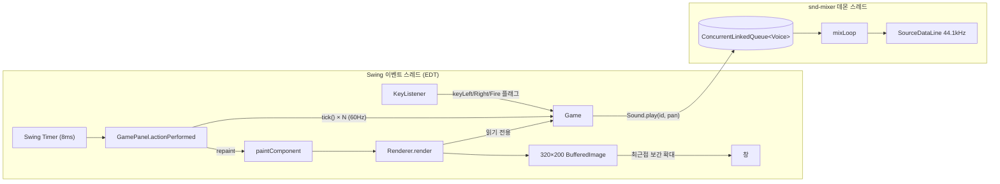
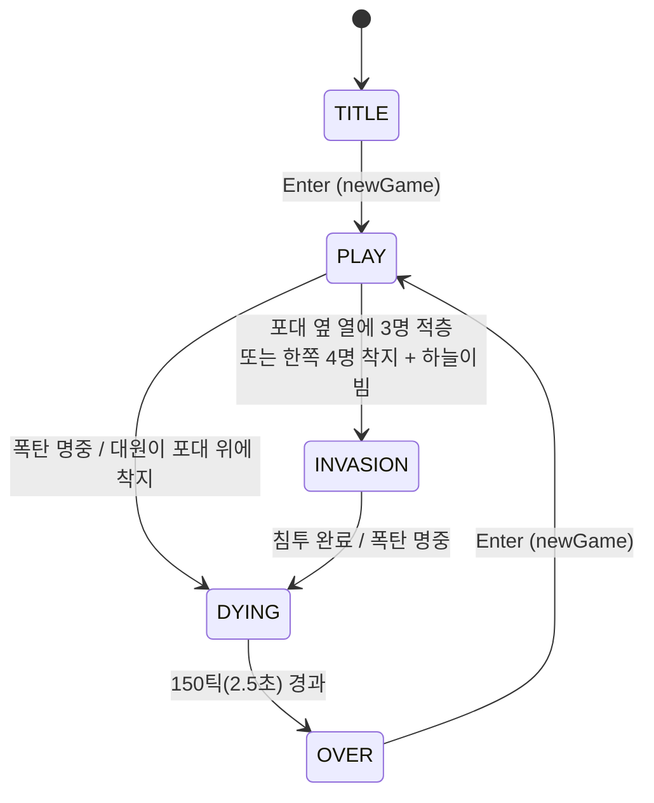
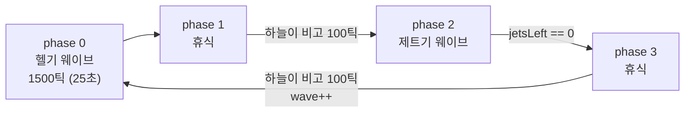
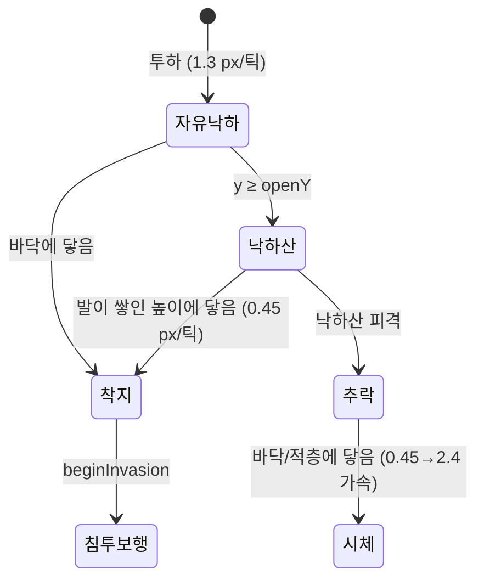
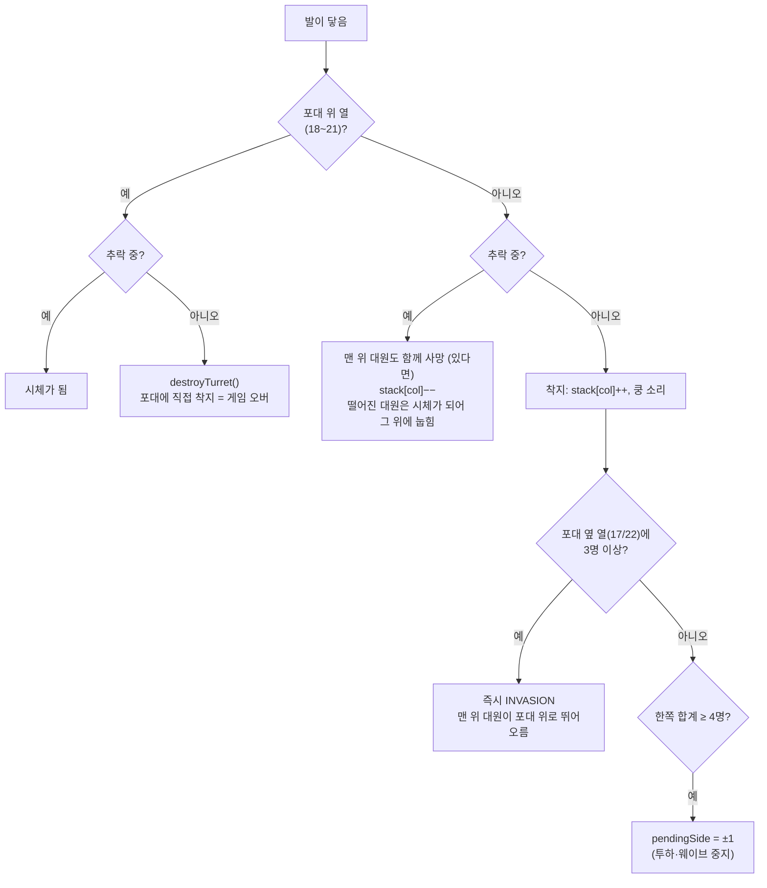

# Paratrooper

1982년 DOS 게임 *Paratrooper* 스타일의 대공포 슈팅 게임입니다. 외부 라이브러리 없이 **Java 표준 라이브러리(Swing + Java Sound)만** 사용하며, Java 8 이상에서 동작합니다.

화면 아래 가운데 있는 포대를 좌우로 돌려 헬기, 제트기, 폭탄, 공수부대원을 쏘아 떨어뜨립니다. 대원이 땅에 쌓여 포대까지 올라오거나 폭탄에 맞으면 게임이 끝납니다.

---

## 목차

1. [빌드와 실행](#1-빌드와-실행)
2. [조작법과 점수](#2-조작법과-점수)
3. [패키지·파일 구조](#3-패키지파일-구조)
4. [전체 아키텍처](#4-전체-아키텍처)
5. [메인 루프: 60Hz 고정 스텝](#5-메인-루프-60hz-고정-스텝)
6. [게임 상태 기계](#6-게임-상태-기계)
7. [좌표계와 화면 배치](#7-좌표계와-화면-배치)
8. [한 틱(tick)에 일어나는 일](#8-한-틱tick에-일어나는-일)
9. [웨이브 진행](#9-웨이브-진행)
10. [엔티티별 동작](#10-엔티티별-동작)
11. [충돌 판정](#11-충돌-판정)
12. [착지, 쌓기, 침투(게임 오버 조건)](#12-착지-쌓기-침투게임-오버-조건)
13. [렌더링](#13-렌더링)
14. [사운드 엔진](#14-사운드-엔진)
15. [튜닝 포인트](#15-튜닝-포인트)

---

## 1. 빌드와 실행

### 터미널

```bash
javac -d out $(find src -name "*.java")
java -cp out pe.kr.architeer.Paratrooper
```

### IntelliJ IDEA

- 프로젝트를 연 뒤 `src/pe/kr/architeer/Paratrooper.java`의 `main`을 실행합니다.
- **Project Structure → Project**에서 SDK와 Language level을 **8 이상**으로 맞춰야 합니다. 현재 설정은 JDK 21, Language level 21입니다.
  - JDK 9 이상은 `release 6`을 지원하지 않습니다. Language level이 6이면 `error: release version 6 not supported`가 납니다.

---

## 2. 조작법과 점수

| 키 | 동작 |
|---|---|
| `←` / `→` | 포신 회전 (틱당 2°, 좌우 최대 86°) |
| `↑` / `Space` | 발사 (12틱, 즉 0.2초마다 1발. 누르고 있으면 연사) |
| `Enter` | 타이틀이나 게임 오버 화면에서 새 게임 시작 |
| `P` | 일시정지 / 재개 |
| `S` | 사운드 켜기 / 끄기 |
| `Esc` | 종료 |

| 행동 | 점수 |
|---|---|
| 발사 1회 | **−1** (0 아래로는 내려가지 않음) |
| 헬기 / 제트기 격추 | +5 |
| 공수부대원 몸통 명중 | +2 |
| 낙하산 명중 (대원이 추락함) | +2 |
| 폭탄 요격 | +25 |

최고 점수(`hiScore`)는 포대가 파괴될 때 갱신됩니다. 메모리에만 있으므로 프로그램을 끄면 사라집니다.

---

## 3. 패키지·파일 구조

```
src/pe/kr/architeer/
├── Paratrooper.java   진입점. 사운드 초기화, JFrame 생성, Swing Timer 시작
├── GamePanel.java     키 입력 → Game 전달, 60Hz 고정 스텝 루프, 화면 확대 출력
├── Game.java          ★ 게임 상태와 모든 규칙 (웨이브·이동·충돌·점수·침투)
├── Renderer.java      Game 상태를 320×200 이미지에 그림
├── Sprites.java       문자열로 정의한 픽셀 스프라이트, 좌우 반전 생성
├── Constants.java     화면·지형 좌표, CGA 팔레트, 속도·난이도 상수
├── State.java         enum State { TITLE, PLAY, INVASION, DYING, OVER }
├── entity/            로직 없는 순수 데이터 클래스
│   ├── Heli.java      헬기 (x, y, 방향, 투하 수, 마지막 검사 열)
│   ├── Jet.java       제트기 (x, y, 방향, 폭탄 투하 여부)
│   ├── Bomb.java      폭탄 (위치, 속도)
│   ├── Shot.java      포탄 (위치, 속도) + 사각형 포함 검사 in()
│   ├── Trooper.java   공수부대원 (위치, 낙하 상태, 열, 침투 경로)
│   ├── Corpse.java    추락사한 대원의 시체 (애니메이션용)
│   └── Bit.java       파편·피·먼지 입자
└── sound/
    ├── Sound.java     효과음 절차적 합성 + 실시간 믹서 스레드
    └── Voice.java     믹서에서 재생 중인 소리 하나
```

**설계 원칙:** 역할을 세 갈래로 나눕니다.

- **규칙(Game):** 화면이나 키보드를 전혀 모릅니다. `keyLeft` 같은 boolean 플래그만 읽습니다.
- **표현(Renderer, Sprites):** `Game`의 필드를 읽어서 그리기만 하고 상태를 바꾸지 않습니다.
- **입출력(GamePanel, Sound):** 실제 키 이벤트, 타이머, 화면, 오디오 장치를 다룹니다.

엔티티는 메서드가 없는 데이터 덩어리이고, 움직임은 모두 `Game`의 `updateXxx()`가 처리합니다.

---

## 4. 전체 아키텍처



- 게임 로직, 입력, 렌더링은 모두 **EDT 한 스레드**에서 돌아갑니다. 그래서 `Game` 필드에 동기화가 필요 없습니다.
- 스레드 경계는 사운드 하나뿐입니다. `Sound.play()`가 락 없는 큐에 `Voice`를 넣고, 믹서 스레드가 꺼내 씁니다.

---

## 5. 메인 루프: 60Hz 고정 스텝

`GamePanel.actionPerformed()`는 Swing Timer가 약 8ms마다 호출합니다.

```java
acc += (now - lastNanos) / 1e9;                       // 흐른 실제 시간 누적
while (acc >= 1/60.0 && steps++ < 5) {                // 1/60초가 쌓일 때마다
    game.tick(); acc -= 1/60.0;                       //   게임을 정확히 한 틱 진행
}
if (acc > 0.1) acc = 0;                               // 크게 밀렸으면 버림
repaint();
```

- **고정 스텝(fixed timestep):** 타이머가 불규칙하게 울려도 게임 시뮬레이션은 항상 1틱 = 1/60초로 진행됩니다. `Constants`의 속도 값은 전부 "틱당 픽셀"이고, 시간 값은 전부 "틱 수"입니다. 예를 들어 `HELI_PHASE_TICKS = 1500`은 25초입니다.
- **나선 방지:** 한 번에 최대 5틱까지만 따라잡습니다. 창을 끌거나 GC가 돌아 0.1초 넘게 밀리면 밀린 시간을 버립니다. 그 덕에 게임이 순간이동하듯 빨라지지 않습니다.
- 렌더링은 틱과 무관하게 타이머가 울릴 때마다 합니다. 화면은 최대 약 120fps, 로직은 60Hz입니다.

---

## 6. 게임 상태 기계



| 상태 | 포탑 조작 | 웨이브 생성 | 대원 투하 | 비고 |
|---|---|---|---|---|
| `TITLE` | ✗ | ✗ | ✗ | `tick()`이 `ticks++`만 하고 바로 반환. 깜빡이는 글자에만 쓰임 |
| `PLAY` | ✓ | ✓ (`pendingSide == 0`일 때) | ✓ | 일반 플레이 |
| `INVASION` | ✓ | ✗ | ✗ | 하늘에 남은 적은 계속 움직이고, 대원이 포대로 걸어감 |
| `DYING` | ✗ | ✗ | ✗ | 큰 폭발 파편이 흩어지는 연출만 진행 |
| `OVER` | ✗ | ✗ | ✗ | "GAME OVER" 표시 |

`paused`는 상태와 별개인 플래그입니다. 켜져 있으면 `tick()`이 아무것도 갱신하지 않습니다.

**`destroyTurret()`** 은 게임 오버로 가는 유일한 입구입니다. `PLAY`나 `INVASION`일 때만 동작하고, 다음 일을 합니다.
- 상태를 `DYING`으로 바꾸고 타이머를 150틱으로 맞춤
- `hiScore` 갱신
- 포탑 위치에 파편 90개짜리 큰 폭발 생성

---

## 7. 좌표계와 화면 배치

내부 해상도는 **CGA 320×200**이며 4색(검정, 청록, 자홍, 흰색)만 씁니다. y축은 아래로 갈수록 커집니다.

```
x: 0                       144   160   176                       320
y:0 ┌─────────────────────────────────────────────────────────────┐
    │  헬기 고도  y = 6, 19, 32, 45   (lane 0~3)                   │
    │  제트기 고도 y = 8, 18, 28                                   │
    │                                                             │
    │  ← 낙하 열: 8px 격자 40칸 (col 0 ~ 39) →                    │
    │                                                             │
    │                         ┌─포탑─┐  PIVOT (160,162)           │
170 │                     ┌───┴──────┴───┐ BASE_TOP = 170         │
    │   [쌓인 대원들]     │    포대       │   [쌓인 대원들]        │
186 ├─────────────────────┴──────────────┴────────────────────────┤ GROUND = 186
    │ SCORE: n                                        HI-SCORE: n │
200 └─────────────────────────────────────────────────────────────┘
```

| 상수 | 값 | 의미 |
|---|---|---|
| `GROUND` | 186 | 대원의 발이 닿는 지면 y |
| `BASE_X, BASE_W, BASE_H` | 144, 32, 16 | 포대 사각형 (x 144~175, y 170~185) |
| `PIVOT_X, PIVOT_Y` | 160, 162 | 포신 회전축. 포탄이 나가는 기준점이자 폭탄이 노리는 지점 |
| `COL_W, COLS` | 8, 40 | 대원이 떨어지고 쌓이는 **열 격자** |
| `BASE_COL_L ~ BASE_COL_R` | 18 ~ 21 | 포대 바로 위의 열 |
| 포대 옆 열 | 17, 22 | 여기에 3명이 쌓이면 즉시 침투 |
| `GY` | 178 | 지면에 선 대원의 y (`GROUND − TR_H`) |

**포신 각도:** `angle = 0`이 수직 위쪽이고, 양수면 오른쪽으로 기웁니다. 그래서 방향 벡터는 `(sin a, −cos a)`입니다.

**열 격자가 핵심입니다.** 대원은 x 좌표를 연속값으로 쓰지 않고 `col`에 고정돼 똑바로 떨어집니다. `stack[col]`이 그 열에 착지한 인원 수입니다. 덕분에 "쌓기"를 픽셀 충돌 없이 정수 배열 하나로 처리합니다.

---

## 8. 한 틱(tick)에 일어나는 일

`Game.tick()`의 순서입니다.

```
ticks++
일시정지 또는 TITLE이면 → 끝
PLAY 또는 INVASION이면:
    updateTurret()            키 플래그로 회전, 쿨다운 감소, 발사
    PLAY이고 pendingSide==0이면 updateWaves()   적 생성
updateHelis()                 이동, 화면 밖 제거, 대원 투하
updateJets()                  이동, 폭탄 투하
updateBombs()                 이동, 포탑 명중 검사
updateTroopers()              낙하, 착지, 적층, 침투 조건 검사
updateCorpses()               시체 나이 증가, 수명 끝나면 제거
updateShots()                 포탄 이동(4분할) + 충돌
updateBits()                  입자 이동(중력 0.05), 수명 감소
PLAY이고 pendingSide≠0이며 skyClear()이면 → beginInvasion()
INVASION이면 → updateInvasion()
DYING이면 dyingTimer 감소 → 0이 되면 OVER
```

리스트 순회 중 제거는 모두 `Iterator.remove()`로 합니다. `ConcurrentModificationException`을 피하기 위해서입니다.

---

## 9. 웨이브 진행

`phase` 값에 따라 네 단계를 반복하고, 한 바퀴 돌 때마다 `wave`가 1씩 오릅니다.



### phase 0: 헬기
- 고도 레인 수가 시간에 따라 1개에서 4개로 늘어납니다: `lanes = 1 + min(3, phaseT × 4 / 1500)`. 갈수록 낮은 고도까지 헬기가 다닙니다.
- 무작위로 고른 레인에서 `y = 6 + lane × 13`에 헬기가 생깁니다. 짝수 레인은 왼쪽→오른쪽, 홀수 레인은 반대 방향입니다. 같은 고도의 헬기는 항상 같은 방향이므로 서로 겹치지 않습니다.
- 생성 간격은 `max(25, 70 − wave × 8) + rand(0..39)` 틱입니다. 웨이브가 오를수록 촘촘해집니다.

### phase 2: 제트기
- 대수는 `round((2 + wave) × 2.5)`입니다. wave 0이면 5대, wave 1이면 8대입니다.
- 80틱마다 1대씩, 무작위 방향과 고도 8, 18, 28 중 하나로 나옵니다.

### 휴식 (phase 1, 3)
- 헬기, 제트기, 폭탄이 모두 사라진 뒤 100틱을 더 기다렸다가 다음 단계로 넘어갑니다.

`pendingSide ≠ 0`(한쪽에 4명 착지)이 되면 `updateWaves()` 자체가 멈춥니다. 새 적이 더 나오지 않고, 침투가 시작되기를 기다립니다.

---

## 10. 엔티티별 동작

### Heli (헬기): 대원 투하
- 속도는 틱당 1.2px입니다. 화면 밖(`x < −30` 또는 `x > W + 6`)으로 나가면 제거됩니다.
- 헬기 중심이 **새 열에 들어설 때마다**(`col != lastCol`) 한 번씩 투하 확률을 굴립니다. 판정이 틱마다가 아니라 열마다라서 속도와 무관하게 공정합니다.
  - 확률은 `min(0.10, 0.035 + wave × 0.01)`입니다. 포대 위 열(18~21)에서는 0.3배로 줄어듭니다.
  - 헬기 한 대가 최대 3명까지 떨어뜨립니다. 양끝 열(0, 39)에서는 떨어뜨리지 않습니다.
  - 상태가 `PLAY`이고 `pendingSide == 0`일 때만 투하합니다.
- 대원은 `x = col × 8 + 2`, `y = 헬기 y + 10`에서 생깁니다. 낙하산이 펴지는 높이 `openY`는 60~114 사이에서 무작위로 정해집니다.

### Jet (제트기): 폭탄 투하
- 속도는 틱당 2.4px입니다. 포탑과의 수평 거리가 110px 안으로 들어오면 폭탄을 **딱 한 번** 떨어뜨립니다.
- 폭탄의 속도 벡터는 투하 순간 **포탑 회전축을 향한 단위 벡터 × 1.4**로 정해집니다. 이후로는 방향을 바꾸지 않고 직선으로 날아갑니다. 투하할 때 휘파람 소리가 납니다.

### Bomb (폭탄)
- 회전축에서 6px 안에 들어오거나 `y > BASE_TOP`이 되면 `destroyTurret()`이 불립니다.
- 포탄으로 요격할 수 있습니다(+25점).

### Trooper (공수부대원): 낙하 상태



| 필드 | 의미 |
|---|---|
| `chute` | 낙하산이 펴져 있음 |
| `chuteLost` | 낙하산을 잃고 추락 중 (`vy`가 0.45에서 틱당 0.03씩 늘어 최대 2.4) |
| `landed` | 착지함. 이후로는 낙하 갱신과 피격 판정에서 빠짐 |
| `path` | 침투 때 따라갈 경유점 목록 |

참고로 낙하산이 펴지기 전에 바닥에 닿은 대원도 그대로 착지합니다. 추락사하는 경우는 낙하산이 피격된 경우(`chuteLost`)뿐입니다.

### Shot (포탄)
- 회전축에서 포신 길이(16px)만큼 떨어진 포구에서 나가며, 속도는 틱당 3px입니다.
- **4분할 이동(`SHOT_SUBSTEPS`):** 한 틱에 0.75px씩 4번 나눠 움직이며 매번 충돌을 검사합니다. 빠른 포탄이 작은 표적을 건너뛰고 지나가는 터널링 현상을 막기 위해서입니다.
- 화면 왼쪽, 오른쪽, 위로 나가거나 무언가에 맞으면 제거됩니다.

### Corpse (시체)와 Bit (입자)
- `Corpse`는 충돌 판정 없이 240틱(4초) 동안 애니메이션만 보여 주고 사라집니다. 자세한 내용은 [13장](#13-렌더링)에 있습니다.
- `Bit`은 위치, 속도, 색, 수명만 가진 입자입니다. 매 틱 `vy += 0.05`의 중력을 받고, 수명이 다하거나 지면에 닿으면 사라집니다.
  - 폭발 `explode()`: 무작위 방향으로 퍼지는 3색 파편입니다. `big`이면 더 빠르고 오래 남습니다.
  - 추락사 `fallDeath()`: 위로 튀는 자홍 8개(피)와 청록 4개(흙먼지)입니다.

---

## 11. 충돌 판정

모두 **축 정렬 사각형(AABB) 안에 점이 들어 있는지**로 판정합니다. 포탄은 점으로 취급하고, `Shot.in(x, y, w, h)`를 씁니다.

`hitSomething()`은 아래 순서로 검사하고, **처음 맞은 하나만** 처리한 뒤 `true`를 반환합니다. 포탄 하나로 여러 대상을 동시에 맞힐 수 없습니다.

| 순서 | 대상 | 판정 영역 | 결과 |
|---|---|---|---|
| 1 | 폭탄 | 중심 ±3.5px | +25, 작은 폭발 |
| 2 | 헬기 | 24×9 | +5, 공중 폭발(파편 22) |
| 3 | 제트기 | 24×7 | +5, 공중 폭발 |
| 4a | 대원 몸통 | 7×8 (추락 중이면 사방 2px 확대) | +2, 제거 |
| 4b | 낙하산 | 대원 위쪽 11×8 | +2, `chuteLost = true` → 추락 |

착지한 대원(`landed`)은 맞지 않습니다. 땅에 내려온 대원은 포탄으로 없앨 수 없고, 낙하산을 쏴서 떨어뜨린 대원으로 **깔아뭉개는** 방법만 있습니다(다음 장).

---

## 12. 착지, 쌓기, 침투(게임 오버 조건)

### 착지 높이
열 `col`에서 착지할 수 있는 높이는 다음과 같습니다.

```
limit = GROUND − stack[col] × TR_H      // 이미 쌓인 인원만큼 8px씩 위
```

대원의 발(`y + 8`)이 `limit`에 닿으면 착지 처리를 합니다.

### 경우별 처리 (`updateTroopers`)



**추락 대원이 맨 위 대원을 깔아뭉개는 구현:** 순회 도중에 다른 원소를 리스트에서 바로 지울 수 없습니다. 그래서 깔린 대원에 `col = −1`, `y = −1000`, `chuteLost = true`, `landed = false`를 표시해 두고, 루프가 끝난 뒤 `col == −1`인 대원을 한꺼번에 제거합니다.

### 침투 1: 포대 옆에 3명이 쌓인 경우
옆 열(17 또는 22)에 3명이 쌓이면, 방금 착지한 맨 위 대원 혼자 경로 `(150, GY−16)`을 따라 포대 위로 걸어 올라갑니다. 오른쪽이면 좌우를 뒤집은 좌표를 씁니다.

### 침투 2: 한쪽에 4명이 착지한 경우 (인간 피라미드)
1. 포대 왼쪽(또는 오른쪽) 전체 착지 인원이 4명 이상이 되면 `pendingSide`를 정합니다. 이때부터 새 적과 투하가 멈춥니다.
2. 남은 헬기, 제트기, 폭탄, 낙하 중인 대원이 모두 사라지면(`skyClear()`) `beginInvasion(side)`가 호출됩니다.
3. 그쪽 착지 대원 중 포탑에 **가까운 순서로 4명**을 골라 지면(`GY`)으로 내리고, 각자에게 경유점을 줍니다. 아래 좌표는 왼쪽 기준입니다.

| 순번 | 경로 | 역할 |
|---|---|---|
| 1 | (138, GY) | 포대 벽에 붙어 섬 |
| 2 | (132, GY) → (132, GY−8) → (138, GY−8) | 1번 어깨 위로 |
| 3 | (132, GY) | 1번 옆에 섬 |
| 4 | (126, GY) → 3번 위 → 2번 위 → (150, GY−16) | 피라미드를 밟고 포탑으로 |

4. `updateInvasion()`은 `walkerIdx`번째 대원 **한 명씩** 경유점을 향해 틱당 0.6px로 직선 이동시킵니다. 12틱마다 발소리를 냅니다. 마지막 대원의 경로가 끝나면 `destroyTurret()`이 호출됩니다.

**`mirror(x, side)`:** 오른쪽 침투는 좌표를 따로 정의하지 않습니다. `W − TR_W − x`로 좌우를 뒤집어 같은 경로 표를 재사용합니다.

> 침투 중에도 포탑은 회전하고 발사할 수 있습니다. 하지만 착지한 대원은 포탄에 맞지 않으므로 침투를 막을 수는 없습니다. 이 단계는 사실상 패배 연출입니다.

---

## 13. 렌더링

### 2단계 출력 (`GamePanel.paintComponent`)
1. `Renderer.render()`가 **320×200 `BufferedImage`** 에 1:1 픽셀로 그립니다. 안티앨리어싱은 꺼 둡니다.
2. 그 이미지를 창 크기에 맞춰 **비율을 유지한 채** 확대해 가운데에 그립니다. 남는 부분은 검은 여백이 됩니다. 보간은 `NEAREST_NEIGHBOR`라서 확대해도 픽셀이 뭉개지지 않고 각진 도트 느낌이 유지됩니다. 기본 창 크기는 3배인 960×600입니다.

### 그리는 순서 (뒤에 그릴수록 위에 보임)
배경 → 지면 선 → 포대 → 포탑(`DYING`과 `OVER`에서는 생략) → 헬기 → 제트기 → 폭탄 → 시체 → 대원과 낙하산 → 포탄 → 입자 → 점수 → 타이틀, 게임 오버, 일시정지 문구

### 스프라이트 (`Sprites`)
이미지 파일 없이 **문자열 배열**로 픽셀을 정의합니다.

```java
static final BufferedImage TROOPER_A = sprite(
        ".www.",    // w = 흰색 (헬멧)
        ".www.",
        "..c..",    // c = 청록 (몸)
        "ccccc",
        ...);       // . = 투명,  m = 자홍
```

- `sprite(rows...)`: 각 문자를 팔레트 색으로 바꿔 ARGB 이미지를 만듭니다.
- `flip(img)`: 좌우 반전본을 만듭니다(`_L` 접미사). 왼쪽으로 가는 헬기와 제트기, 왼쪽으로 쓰러지는 시체에 씁니다.

### 애니메이션
| 대상 | 방식 |
|---|---|
| 헬기 로터 | `(ticks / 3) % 2`로 `HELI_A`와 `HELI_B`를 번갈아 표시 (3틱마다 전환) |
| 걷는 대원 | 침투 중인 현재 대원만 `(ticks / 6) % 2`로 다리 프레임 전환 |
| 깜빡이는 문구 | `(ticks / 30) % 2` (0.5초 간격) |
| 시체 | 나이(`age`)에 따른 타임라인 (아래 표) |

시체 타임라인 (`Renderer.drawCorpse`):

| age (틱) | 스프라이트 | 연출 |
|---|---|---|
| 0–5 | `DEAD_SQUASH` | 쿵 하고 찌그러짐 |
| 6–11 | `DEAD_TILT` | 옆으로 기울어짐 |
| 12–14 | `DEAD_A` (+1px 위로) | 쓰러지며 한 번 튕김 |
| 15–69 | `DEAD_A` / `DEAD_B` | 28, 44, 58틱 무렵 점점 짧아지는 경련 |
| 70~ | `DEAD_LIMP` | 팔이 툭 떨어지며 축 늘어짐 |
| 200–239 | (위와 동일) | 4틱 간격으로 깜빡이다 240틱에 제거 |

---

## 14. 사운드 엔진

음원 파일 없이 **시작할 때 코드로 파형을 합성**하고, 전용 스레드에서 실시간으로 믹싱합니다.

### 초기화와 합성 (`Sound.init` → `mixLoop` → `build`)
- `init()`은 `snd-mixer` 데몬 스레드만 띄웁니다. 합성은 그 스레드 안에서 하므로 게임 시작이 지연되지 않습니다.
- `build()`는 효과음 8종을 각각 2~4개 변형으로 미리 만들어 `bank[id][variant]`(float 샘플 배열)에 저장합니다. 변형마다 시드가 `id × 1000 + v`로 고정돼 있어서 매번 같은 소리가 나옵니다.
- 오디오 장치를 열지 못하면 `enabled = false`로 두고 조용히 넘어갑니다. 게임은 소리 없이 계속됩니다.

| ID | 소리 | 합성 방식 |
|---|---|---|
| `FLAK` | 발사 | 고역 노이즈 파열음 + 저음 주파수 스윕 + 필터링된 노이즈 + 노리쇠 금속음(사인파 3개) |
| `POP` | 작은 폭발 | `blast()` 짧은 버전 |
| `BLAST_AIR` | 헬기·제트기 격추 | `blast()` + 메아리 |
| `BLAST_BIG` | 포대 파괴 | 긴 `blast()` + 유폭 5회 + 메아리 |
| `WHISTLE` | 폭탄 낙하 | 2kHz 근처에서 지수적으로 내려가는 사인파 + 약간의 비브라토 |
| `THUD` | 착지 | 짧은 저음 사인파 + 저역 노이즈 |
| `STEP` | 발걸음 | 더 짧고 작은 `thud()` |
| `SPLAT` | 추락사 | 묵직한 `thud()` + 짧은 파열음 3개 |

자주 쓰는 DSP 도구:
- `lp(hz)`: 1극 저역통과 필터 계수. `y += lp(hz) × (x − y)` 형태로 씁니다.
- `env(t, attack, decay)`: 선형으로 올라갔다가 지수적으로 감쇠하는 엔벨로프입니다.
- `echo(s, delay, fb)`: 피드백 딜레이(메아리)입니다.
- `norm(s, peak)`: 최댓값을 `peak`에 맞추고 끝 30ms를 페이드아웃해 클릭음을 없앱니다.

### 재생 요청 (`Sound.play(id, pan)`)
게임 스레드에서 호출되며 바로 반환합니다.
1. 변형 하나를 무작위로 고릅니다.
2. 재생 속도 `step`을 0.94~1.06 사이로 정해 음높이를 살짝 흔듭니다. 같은 소리가 반복돼도 기계적으로 들리지 않게 하기 위해서입니다.
3. **등전력 패닝**으로 좌우 게인을 정합니다: `a = (pan + 1) × π/4`, `gl = cos a`, `gr = sin a`. `pan`은 `Game.pan(x)`가 화면 x 좌표를 −0.8~0.8로 바꾼 값입니다. 그래서 소리가 실제로 난 위치에서 들립니다.
4. `ConcurrentLinkedQueue`에 넣습니다.

### 믹싱 루프
44.1kHz, 16bit, 스테레오이고, 블록 크기는 256프레임(약 5.8ms)입니다.

```
반복:
  큐에서 새 Voice를 꺼내 voices에 추가 (32개 초과 시 가장 오래된 것 제거)
  mix[] = 0
  각 Voice:  pos를 step씩 전진하며 선형 보간한 샘플 × gl/gr을 mix[]에 더함
            끝까지 재생했으면 제거
  각 샘플:  tanh(mix × 0.9) × 32000 → 16bit little-endian
  line.write(...)   ← 버퍼가 차면 여기서 대기 (자연스럽게 실시간 속도가 맞춰짐)
```

- **소프트 클리핑(`tanh`):** 폭발음 여러 개가 겹쳐 합이 1을 넘어도 딱딱하게 잘리지 않고 부드럽게 눌립니다.
- 라인 버퍼는 약 23ms로 작게 잡아서, 발사 키를 누르고 소리가 나기까지 지연이 짧습니다.
- `S` 키로 `enabled`를 끄면 다음 블록부터 재생 중인 소리도 모두 비웁니다. `enabled`와 `ready`는 `volatile`이라 스레드 간에 바로 보입니다.

---

## 15. 튜닝 포인트

난이도와 느낌은 대부분 `Constants.java`에서 바꿀 수 있습니다.

| 바꾸고 싶은 것 | 위치 |
|---|---|
| 포신 회전 속도 / 최대 각도 | `TURN_SPEED`, `MAX_ANGLE` |
| 연사 속도 / 포탄 속도 | `FIRE_COOLDOWN`, `SHOT_SPEED` |
| 적 속도 | `HELI_SPEED`, `JET_SPEED`, `BOMB_SPEED` |
| 낙하 속도 | `FALL_FREE`, `FALL_CHUTE`, `FALL_DEAD`, `FALL_ACCEL` |
| 헬기 웨이브 길이 | `HELI_PHASE_TICKS` |
| 제트기 대수 | `JET_WAVE_MULT` |
| 시체가 남는 시간 | `DEAD_TICKS` |
| 화면 기본 배율 | `SCALE` |
| 투하 확률, 생성 간격, 헬기당 최대 투하 수 | `Game.updateHelis()`, `Game.updateWaves()`의 숫자 |
| 침투 조건 (3명 / 4명) | `Game.updateTroopers()` |
| 점수 배점 | `Game.hitSomething()`, `Game.updateTurret()` |
